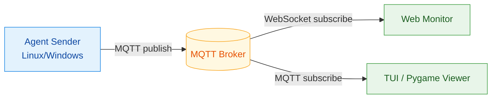

# hwmonitor-mqtt

[](https://www.docker.com/)
[](https://www.python.org/)
[](https://mqtt.org/)
[](./LICENSE)

把硬體監控變成「即時可視化資料流」：
- Agent 低負擔採集 CPU/RAM/Disk/Network/GPU/Temperature。
- MQTT 做資料總線，支援多主機擴充。
- Web 與本機 Viewer 即時呈現，不必重後端。

## 為什麼值得用

- 低門檻：`docker compose` 一鍵起服務。
- 低耦合：採集、訊息、顯示分離。
- 可擴展：同時支援 Linux / Windows Agent 與 ESP 輕量 payload。
- 可維護：文件與 Python 檔案已分層，路徑更清楚。

## 架構圖（含圖例）



### 圖例說明

- 藍色節點：資料生產者（Agent）
- 黃色節點：訊息中樞（Broker）
- 綠色節點：資料消費者（Web/TUI/Pygame）
- 箭頭標籤：通訊方式（`MQTT publish` / `subscribe` / `WebSocket`）

## Viewer 預覽

### PyGame Viewer


### TUI Viewer


## 專案結構

```text
.
├─ hwmonitor_mqtt/
│  ├─ agents/
│  │  ├─ agent_sender_async.py
│  │  └─ agent_sender_windows.py
│  └─ viewers/
│     ├─ pygame_viewer.py
│     └─ tui_viewer.py
├─ wifi_portal/
├─ docs/
│  ├─ getting-started/
│  ├─ architecture/
│  ├─ deployment/
│  ├─ configuration/
│  ├─ hardware/
│  └─ troubleshooting/
├─ tests/
└─ docker-compose.yml
```

> 主要執行入口已統一到 `hwmonitor_mqtt/` 套件路徑。

## 快速開始

### 1. 設定環境

```bash
cp .env.example .env
```

至少設定：`BROKER_HOST`、`BROKER_PORT`、`MQTT_USER`、`MQTT_PASS`。

### 2. 啟動模式

只啟動 Agent：

```bash
docker compose --profile agent up -d
```

完整模式（Agent + Broker + Web）：

```bash
docker compose --profile full up -d
```

ESP 輕量模式：

```bash
docker compose --profile esp-agent up -d
```

### 3. 觀察狀態

```bash
docker compose ps
docker compose logs -f
```

Web 介面預設：`http://localhost:8088`

## 文件入口

- [文件中心](./docs/README.md)
- [快速開始](./docs/getting-started/quickstart.md)
- [部署說明](./docs/deployment/docker-profiles.md)
- [環境變數](./docs/configuration/env-vars.md)
- [系統架構](./docs/architecture/system-overview.md)
- [硬體設定](./docs/hardware/README.md)
- [疑難排解](./docs/troubleshooting/common-issues.md)

## Python 開發

本專案有 `pyproject.toml`，建議使用 `uv`：

```bash
uv sync
uv run pytest -q
```

## 在 Linux 或 PVE 安裝 Sender

在要監控的 Linux 或 Proxmox VE 主機執行以下準備步驟。安裝器需要 Git 與 Python 3.11 以上；一般 Linux 使用 Docker Compose v2，PVE 原生安裝另需 `python3-venv` 與 systemd。一般 Linux 的 Docker 必須先由管理者安裝。

```bash
git clone https://github.com/KarlSideProjects/hwmonitor-mqtt.git
cd hwmonitor-mqtt
test -e .env || cp .env.example .env
chmod 600 .env
nano .env
```

在 `.env` 設定 `BROKER_HOST`、`BROKER_PORT`、`MQTT_USER` 與 `MQTT_PASS`。`chmod 600` 限制 MQTT 憑證檔案的讀取權限。

一般 Linux 使用 Docker Compose。先預覽系統判斷與安裝命令，再安裝並啟動 sender：

```bash
bash install.sh --dry-run
sudo bash install.sh
```

dry-run 不會安裝或啟動服務。PVE 預設使用原生 systemd sender；先依下列步驟完成私有 API 設定和 CA，再以 sudo 預覽並安裝。

PVE 需要 HTTPS API 唯讀 token、可信 CA，以及穩定的 cluster ID 和 node 名稱。token 需透過 ACL 繼承取得 `/vms` 的 `VM.Audit`，並以 `Sys.Audit` 讀取 `/access` ACL；每個明列的 `/vms` ACL 範圍也需有 `VM.Audit`。目前所有有效權限都必須以 `.Audit` 結尾，且可見的叢集 ACL 不可包含 `/pool/...` 項目。完整權限與 scope 限制見 [PVE sender 設定說明](docs/configuration/env-vars.md#proxmox-ve-sender)。先建立私有設定檔；若檔案已存在，保留原檔並自行合併設定：

若已用 `root` 登入 PVE，以下命令可省略 `sudo`。建立私有設定檔、預覽與安裝都必須以 root 執行。

```bash
sudo install -d -m 0755 /etc/hwmonitor-mqtt
if ! sudo test -e /etc/hwmonitor-mqtt/pve.env; then
  sudo install -m 0600 docs/configuration/pve.env.example /etc/hwmonitor-mqtt/pve.env
fi
sudoedit /etc/hwmonitor-mqtt/pve.env
```

將範例中的 URL、token、cluster ID、node 和 CA 路徑改成實際值。不要把 token 貼進 Git 或公開輸出。範例 CA 路徑是 `/etc/hwmonitor-mqtt/pve-root-ca.pem`；將 `/path/to/trusted-pve-root-ca.pem` 換成 CA 檔的實際來源路徑：

```bash
CA_SOURCE='/path/to/trusted-pve-root-ca.pem'
test -f "$CA_SOURCE"
if ! sudo test -e /etc/hwmonitor-mqtt/pve-root-ca.pem; then
  sudo install -m 0644 "$CA_SOURCE" /etc/hwmonitor-mqtt/pve-root-ca.pem
fi
```

`/etc/hwmonitor-mqtt` 目錄使用 `0755`，CA 檔使用 `0644`，讓服務身分可讀取 CA。確認 token、設定及 CA 已準備好後，在 PVE 宿主以 sudo 預覽，再安裝原生 systemd sender：

```bash
sudo bash install.sh --dry-run
sudo bash install.sh
```

若要選用 Docker Compose，改以 `sudo bash install.sh --deployment docker` 安裝；Docker 版也會驗證 PVE API 設定。

安裝器支援目前已驗證的 Debian、Ubuntu 與 Raspberry Pi OS；其他 Linux 發行版會停止並回報不支援。Windows 請使用 [Windows sender 安裝方式](#windows-sender-安裝與注意事項)。PVE 原生與 Docker 安裝命令尚未在實際 PVE 主機執行；設定格式及安裝分支以自動化測試驗證，實際部署仍需操作者確認服務與資料流。

## 授權

本專案採用 `GNU GPL v3.0`。  
可商用，但散佈修改版或衍生作品時，需依 GPL 條款提供對應原始碼。詳見 [LICENSE](./LICENSE)。

## Windows Sender 安裝與注意事項

建議使用「系統管理員」PowerShell 執行以下步驟。

### 1. 準備 `.env`

```powershell
Copy-Item .env.example .env
```

請至少確認：
- `BROKER_HOST`
- `BROKER_PORT`
- `MQTT_USER`
- `MQTT_PASS`

### 2. 安裝 Windows sender 排程（建議開機自動啟動）

```powershell
powershell -ExecutionPolicy Bypass -File .\scripts\windows\install_windows_sender_task.ps1 -AtStartup
```

說明：
- 會優先使用 `uv`（若可用），並執行 `uv sync` 安裝依賴。
- 會自動檢查/安裝 LibreHardwareMonitor 到 `third_party/librehardwaremonitor`（預設啟用）。
- `-AtStartup` 會用 `SYSTEM` 建立排程，通常可避免 UAC 導致的 LHM 啟動問題。

### 3. 啟動與檢查

```powershell
Start-ScheduledTask -TaskName HWMonitorMQTTSender
Get-ScheduledTaskInfo -TaskName HWMonitorMQTTSender
```

### 4. 重要注意事項

- 不要同時啟動多個 sender 實例，否則 viewer 可能出現 CPU/GPU 資料跳動或 `NA` 閃爍。
- 若看到 `Access is denied (0x80070005)`，請改用系統管理員 PowerShell。
- 若看到 `WinError 740`，代表目前權限不足以啟動 LibreHardwareMonitor。
- Windows sender 會先嘗試 WMI；若 WMI 回傳空資料，會改用 `LibreHardwareMonitorLib.dll`（`pythonnet`）讀取感測器，並保留 `nvidia-smi` fallback。
- 安裝後通常不需要重開機。

### 5. 清理重複 sender（必要時）

```powershell
Get-CimInstance Win32_Process |
  Where-Object { $_.CommandLine -match 'hwmonitor_mqtt\.agents\.agent_sender_(windows|async)' -or $_.CommandLine -match 'start_windows_sender\.ps1' } |
  Select-Object ProcessId, Name, CommandLine

# 確認後再停止
Get-CimInstance Win32_Process |
  Where-Object { $_.CommandLine -match 'hwmonitor_mqtt\.agents\.agent_sender_(windows|async)' -or $_.CommandLine -match 'start_windows_sender\.ps1' } |
  ForEach-Object { Stop-Process -Id $_.ProcessId -Force }
```
