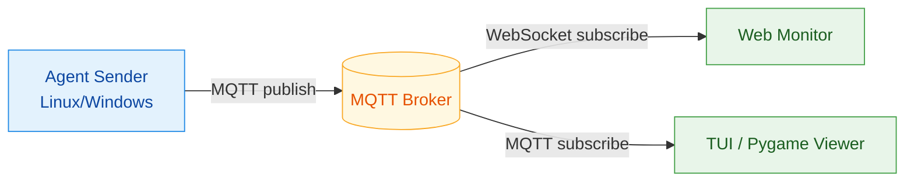

# hwmonitor-mqtt

[](https://www.docker.com/)
[](https://www.python.org/)
[](https://mqtt.org/)
[](./LICENSE)

把硬體監控變成「即時可視化資料流」：
- Agent 低負擔採集 CPU/RAM/Disk/Network/GPU/Temperature。
- MQTT 做資料總線，支援多主機擴充。
- Web 與本機 Viewer 即時呈現，不必重後端。

## 為什麼值得用

- 低門檻：`docker compose` 一鍵起服務。
- 低耦合：採集、訊息、顯示分離。
- 可擴展：同時支援 Linux / Windows Agent 與 ESP 輕量 payload。
- 可維護：文件與 Python 檔案已分層，路徑更清楚。

## 架構圖（含圖例）



### 圖例說明

- 藍色節點：資料生產者（Agent）
- 黃色節點：訊息中樞（Broker）
- 綠色節點：資料消費者（Web/TUI/Pygame）
- 箭頭標籤：通訊方式（`MQTT publish` / `subscribe` / `WebSocket`）

## Viewer 預覽

### PyGame Viewer


### TUI Viewer


## 專案結構

```text
.
├─ hwmonitor_mqtt/
│  ├─ agents/
│  │  ├─ agent_sender_async.py
│  │  └─ agent_sender_windows.py
│  └─ viewers/
│     ├─ pygame_viewer.py
│     └─ tui_viewer.py
├─ wifi_portal/
├─ docs/
│  ├─ getting-started/
│  ├─ architecture/
│  ├─ deployment/
│  ├─ configuration/
│  ├─ hardware/
│  └─ troubleshooting/
├─ tests/
└─ docker-compose.yml
```

> 主要執行入口已統一到 `hwmonitor_mqtt/` 套件路徑。

## 快速開始

### 1. 設定環境

```bash
cp .env.example .env
```

至少設定：`BROKER_HOST`、`BROKER_PORT`、`MQTT_USER`、`MQTT_PASS`。

### 2. 啟動模式

只啟動 Agent：

```bash
docker compose --profile agent up -d
```

完整模式（Agent + Broker + Web）：

```bash
docker compose --profile full up -d
```

ESP 輕量模式：

```bash
docker compose --profile esp-agent up -d
```

### 3. 觀察狀態

```bash
docker compose ps
docker compose logs -f
```

Web 介面預設：`http://localhost:8088`

## 文件入口

- [文件中心](./docs/README.md)
- [快速開始](./docs/getting-started/quickstart.md)
- [部署說明](./docs/deployment/docker-profiles.md)
- [環境變數](./docs/configuration/env-vars.md)
- [系統架構](./docs/architecture/system-overview.md)
- [硬體設定](./docs/hardware/README.md)
- [疑難排解](./docs/troubleshooting/common-issues.md)

## Python 開發

本專案有 `pyproject.toml`，建議使用 `uv`：

```bash
uv sync --locked
make check
```

`make check` 會執行完整 pytest 回歸測試。支援 Python 3.11 與 3.13，PowerShell 測試需 Linux 上的 `pwsh`。

原生 PVE 安裝整合檢查以 Python 3.13 執行，只應在 GitHub-hosted CI 或可丟棄的 Linux VM 執行；它會暫時建立 `/opt` 專案與唯一的 systemd unit，使用 `umask 077`、0600 空白設定與 loopback MQTT broker，結束時移除測試服務及檔案。若 systemd 無法確認服務已停止，檢查會失敗並保留檔案，輸出中會列出需要清理的路徑。請勿在正式主機執行：

```bash
make native-install-smoke
```

## 在 Linux 或 PVE 安裝 Sender

在要監控的 Debian、Ubuntu、Raspberry Pi OS 或 Proxmox VE 主機執行以下命令。需要 `wget` 或 `curl` 其中一項；首次執行會詢問 MQTT 設定，密碼不會顯示，既有 `.env` 會保留。一般 Linux 會準備 Python 與 Docker Compose v2，PVE 使用原生 systemd sender。安裝需要 Python 3.11 以上；bootstrap 安裝系統的 `python3` 後若版本不足會停止，部分舊 Ubuntu（例如 22.04）需先自行安裝 Python 3.11+。請在 root shell 執行。

```bash
u=https://raw.githubusercontent.com/KarlSideProjects/hwmonitor-mqtt/refs/heads/master/bootstrap.sh; f=$(mktemp) && (wget -qO "$f" "$u" || curl -fsSL "$u" -o "$f") && bash "$f"
```

若 PVE 套件來源回報 Enterprise repository 的 401，且目前沒有有效訂閱，bootstrap 會警告後嘗試以現有套件索引安裝必要套件；這不代表 Debian 官方套件來源無法使用。它不會修改或停用任何 PVE/Ceph 套件來源，也不會關閉簽章或來源驗證。

PVE 安裝入口會先檢查舊的 `sys-agent` Docker 容器。容器存在時會停止，請先完成下方遷移，再執行安裝。它會更新下載目錄中的程式，保留既有 `.env` 與私有 PVE 設定。

PVE 本機的節點名稱與 CA 由 PVE 安裝模組準備。模組將本機 `/etc/pve/pve-root-ca.pem` 複製到服務可讀的 `/etc/hwmonitor-mqtt/pve-root-ca.pem`，預設 API URL 使用本機完整主機名稱；HTTPS 憑證仍需符合 URL。cluster ID 用於監控資料識別，並非 API 登入參數。各欄位來源與用途見 [PVE 設定參考](docs/configuration/env-vars.md#proxmox-ve-sender)。既有實際設定保留，範本中的已知範例值會依本機資料補正。

### 安裝檔會做什麼

下載命令執行 `bootstrap.sh`，由它辨識系統並呼叫對應平台模組。它會檢查必要套件，缺少時透過 APT 安裝；一般 Linux 若需要 Docker 官方套件庫，會建立經簽章驗證的套件來源。它會下載或更新 `/opt/hwmonitor-mqtt` 內的程式，保留 MQTT `.env`、PVE 私有設定與 Docker 自訂覆寫檔。一般 Linux 使用 Docker Compose sender；PVE 使用原生 systemd sender。Windows 的 PowerShell 入口會準備 Python/uv、LibreHardwareMonitor 與開機排程。

PVE 分支依序執行下列操作：

1. 檢查舊 `sys-agent` 容器；存在時停止安裝，請先完成下方遷移。
2. 準備本機節點、API URL、cluster ID 與服務可讀的 CA。
3. 沿用既有 token 設定；缺少或仍為範本密鑰時，透過本機 `pveum` 建立監控專用 PVE 帳號與 API token，不建立 Linux 帳號或登入密碼。
4. 將 token ID 與密鑰直接寫入 `/etc/hwmonitor-mqtt/pve.env`，權限為 `0600`，不在終端顯示密鑰。
5. 為新帳號與 token 在 `/` 設定可繼承的 `PVEAuditor` 唯讀角色。token 使用分離權限 (`privsep=1`)，不授予 VM／CT 的啟停或修改權限。
6. 驗證 CA、HTTPS API 與 token scope，再詢問缺少的 MQTT 設定。
7. 將 sender 與 Python 環境安裝至 `/opt/hwmonitor-mqtt-pve`，修正程式目錄與套件的讀取、執行權限，啟用並重啟 `hwmonitor-mqtt-pve.service`，再檢查服務是否為 active。採集服務以非 root 的動態身分執行；MQTT 與 PVE 密鑰檔維持私有權限。

建立帳號、token 與 ACL 是 PVE 設定變更。安裝器為新安裝產生專用名稱，避免擴充其他帳號權限；不刪除或重設既有 token。既有自訂 token ID 缺少密鑰，或密鑰驗證失敗時會停止，不自動替換。只含安裝進度與專用識別碼的 `/etc/hwmonitor-mqtt/pve-token-state.json` 用於失敗重跑；實際密鑰只存在私有 `pve.env`。重裝沿用已保存的密鑰，接續未完成的權限設定。

自動建立 token 的流程已以模擬 `pveum` 測試，實際 PVE 帳號建立與重裝仍待宿主驗證。若要撤銷自動建立的存取權，先停用採集服務，再依狀態檔中的識別碼，在 PVE「Datacenter → Permissions → API Tokens」刪除該 token；專用帳號可在「Users」確認無其他用途後刪除。保留舊容器的回復步驟見下節。

安裝入口會檢查有效的 `VM.Audit`、`Sys.Audit` 與 ACL 範圍；目前有效權限名稱都必須以 `.Audit` 結尾，且可見的叢集 ACL 不可包含 `/pool/...` 項目。完整限制見 [PVE 設定參考](docs/configuration/env-vars.md#proxmox-ve-sender)。看到 `PVE sender is not installed yet` 代表本次尚未安裝完成。一般 Linux 與 Windows 不會建立 PVE 帳號或 token。

### PVE 服務啟動權限

若安裝完成後沒有監控資料，且服務日誌出現 `200/CHDIR` 或 `Permission denied`，可能是舊安裝器在 `umask 077` 下建立了服務無法讀取的程式目錄或 Python 環境。新版安裝器會修正這些執行檔案的權限，保留既有 MQTT 與 PVE token 設定；在 PVE root Shell 重跑 `bash /opt/hwmonitor-mqtt/bootstrap.sh` 即可更新修復。

### PVE HTTPS 連線檢查

HTTPS 連線必須通過設定 CA 的信任鏈與主機名稱驗證。[Python 3.13 起的預設嚴格憑證檢查](https://docs.python.org/3/library/ssl.html#ssl.create_default_context)可能拒絕缺少 key usage 擴充的既有 PVE CA。採集端只在 OpenSSL 明確回報此原因 (驗證碼 `92`) 時，針對該 PVE 連線取消嚴格格式檢查並重試一次；CA 信任、憑證有效期及主機名稱驗證仍保留，不會改動 PVE 的憑證或全域 TLS 設定。

遇到此相容性問題時，在 PVE root Shell 重跑已下載的安裝入口即可更新採集端，無須重建 token：

```bash
bash /opt/hwmonitor-mqtt/bootstrap.sh
```

### 從舊 Docker sender 遷移到 PVE 原生服務

以下遷移步驟尚待 PVE 實機重裝驗證。先退出監控安裝程序，再以 root 執行。此步驟會暫停舊監控；保留舊容器作為回復備份，不影響 CT／VM：

```bash
docker stop sys-agent && docker rename sys-agent sys-agent-before-native
```

重新執行上方下載安裝命令。停止但仍名為 `sys-agent` 的容器也會阻擋安裝；不要執行會停止其他服務的 `docker compose down`。若備份名稱已存在，先檢查既有備份，不要覆寫。

安裝後檢查服務與日誌，並在 R36 開啟 PVE 主機確認 CT／VM 清單：

```bash
systemctl status hwmonitor-mqtt-pve --no-pager
journalctl -u hwmonitor-mqtt-pve -n 30 --no-pager
```

若需回復保留的舊容器，先停用新版，再恢復舊容器名稱與啟動。若新服務尚未建立，略過第一個指令：

```bash
systemctl disable --now hwmonitor-mqtt-pve
docker rename sys-agent-before-native sys-agent && docker start sys-agent
```

安裝器支援 Debian、Ubuntu 與 Raspberry Pi OS；其他 Linux 發行版會停止並回報不支援。PVE 原生安裝與 Windows 排程安裝尚未在實體目標主機驗證。Windows 請使用 [Windows sender 安裝方式](#windows-sender-安裝與注意事項)。

## 授權

本專案採用 `GNU GPL v3.0`。  
可商用，但散佈修改版或衍生作品時，需依 GPL 條款提供對應原始碼。詳見 [LICENSE](./LICENSE)。

## Windows Sender 安裝與注意事項

在「系統管理員」PowerShell 執行以下命令。首次執行會隱藏 MQTT 密碼輸入，並建立僅 Administrators 與 SYSTEM 可讀的 `.env`；既有設定會保留。安裝器會準備 Python/uv、LibreHardwareMonitor 與 PawnIO 驅動，註冊開機排程並立即啟動 sender。

```powershell
irm https://raw.githubusercontent.com/KarlSideProjects/hwmonitor-mqtt/refs/heads/master/bootstrap.ps1 -ErrorAction Stop | iex
```

檢查排程狀態：

```powershell
Get-ScheduledTaskInfo -TaskName HWMonitorMQTTSender
```

### 2. 重要注意事項

- 不要同時啟動多個 sender 實例，否則 viewer 可能出現 CPU/GPU 資料跳動或 `NA` 閃爍。
- 若看到 `Access is denied (0x80070005)`，請改用系統管理員 PowerShell。
- 若看到 `WinError 740`，代表目前權限不足以啟動 LibreHardwareMonitor。
- Windows sender 以 `LibreHardwareMonitorLib.dll`（`pythonnet`）在程序內讀取 CPU/GPU 溫度。LibreHardwareMonitor 0.9.5 起移除 WMI provider，並改用 [PawnIO](https://pawnio.eu/) 驅動取代 WinRing0；未安裝 PawnIO 時 GPU 溫度仍可讀取，CPU 溫度會缺少。安裝器會靜默安裝固定版本與 SHA-256 的 PawnIO 2.2.0。
- 舊版 LibreHardwareMonitor 的 WMI namespace（`root/LibreHardwareMonitor`）與 `nvidia-smi` 仍作為 fallback。
- 安裝後通常不需要重開機；若安裝器顯示 PawnIO 需要重新開機，重開後 CPU 溫度才會出現。

### 3. 清理重複 sender（必要時）

```powershell
Get-CimInstance Win32_Process |
  Where-Object { $_.CommandLine -match 'hwmonitor_mqtt\.agents\.agent_sender_(windows|async)' -or $_.CommandLine -match 'start_windows_sender\.ps1' } |
  Select-Object ProcessId, Name, CommandLine

# 確認後再停止
Get-CimInstance Win32_Process |
  Where-Object { $_.CommandLine -match 'hwmonitor_mqtt\.agents\.agent_sender_(windows|async)' -or $_.CommandLine -match 'start_windows_sender\.ps1' } |
  ForEach-Object { Stop-Process -Id $_.ProcessId -Force }
```
